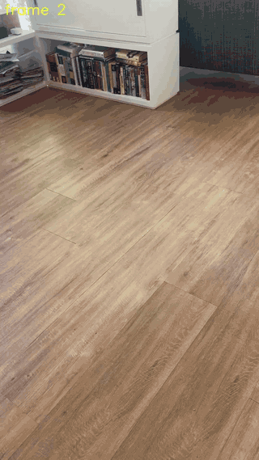
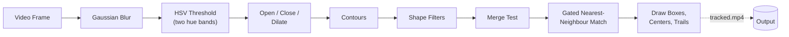
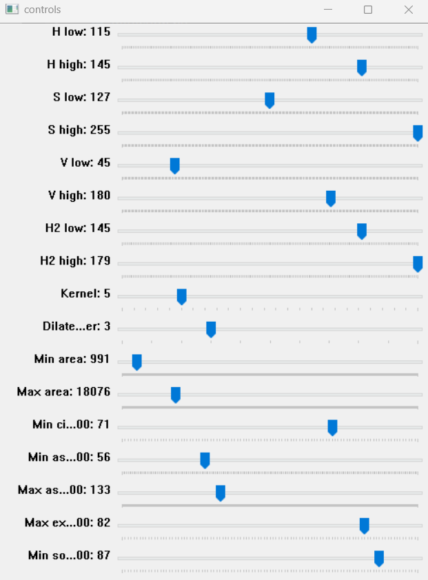
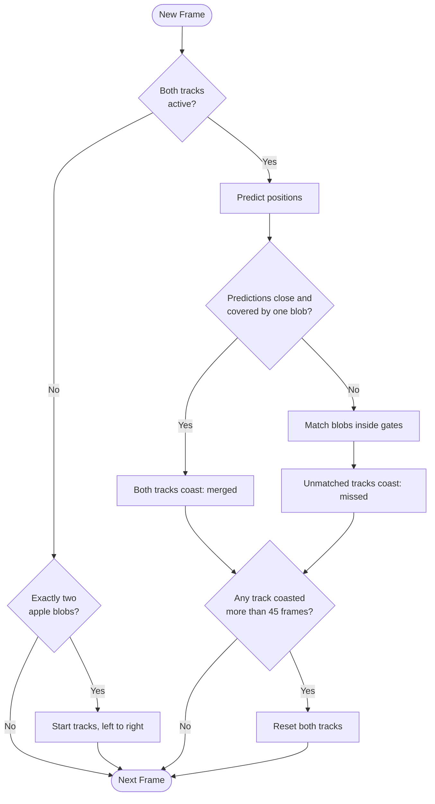
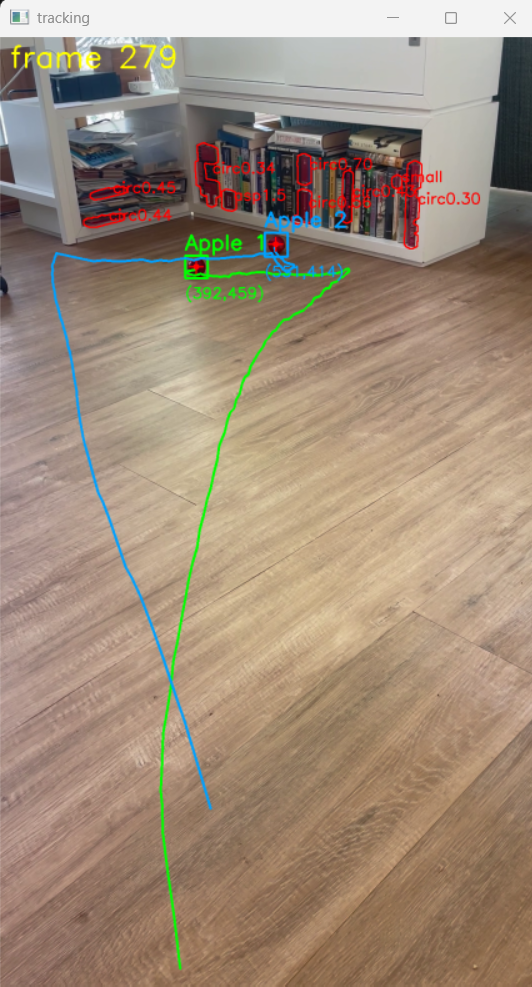

# Simple Object Tracking
**Author:** Joseph Pokuta

**Date:** 10/10/26

A simple blob-based program that detects and tracks two apples through a handheld video using OpenCV, without relying on a learned detector or OpenCV's built-in trackers.

<div align="center">
  
  <br>
  <sup><strong>Demo:</strong> Both apples tracked with their trails (sped up) · <a href="Media/tracked.mp4">full-quality video</a></sup>
</div>

## Implementation
Each frame passes through a color mask, a shape filter, and a two-track association step before being drawn.



### Color Mask
The frame is blurred with a 7x7 Gaussian kernel and converted to HSV. Two hue bands, covering the purple-red end of OpenCV's 0–179 hue range, are thresholded and OR'd together:

| Channel | Range |
| :--- | :---: |
| Hue (band 1) | 115 – 145 |
| Hue (band 2) | 145 – 179 |
| Saturation | 127 – 255 |
| Value | 45 – 180 |

The mask is then cleaned with a morphological open (removes speckle), a close (fills holes), and 3 iterations of dilation using a 5x5 elliptical kernel.

### Shape Filters
Every contour in the mask is measured, and a blob only counts as an apple if it passes all of the following checks. Blobs that fail are labeled with the reason they failed (e.g. `circ0.45`) when debug mode is on.

* **Area:** between 991 and 18076 px
* **Circularity:** $\frac{4\pi A}{P^2} \geq 0.71$
* **Aspect Ratio:** height / width between 0.56 and 1.33
* **Extent:** area / bounding box area $\leq 0.82$
* **Solidity:** area / convex hull area $\geq 0.87$

The thresholds were tuned by hand for this specific video with a set of OpenCV trackbars, so that only the apples pass and everything else in the scene is rejected. The tuned values are the defaults in `DetectParams`, and the trackbars can be brought back with tune mode (see [How to Run](#how-to-run)).

<div align="center">
  
  <br>
  <sup><strong>Tuning:</strong> The trackbar window used to find the color and shape thresholds.</sup>
</div>

### Tracking
Two tracks (`Apple 1` and `Apple 2`) are kept for the whole video.
* **Start:** Tracking only begins once exactly two apple-shaped blobs are seen in the same frame. They are assigned left to right.
* **Prediction:** Each track predicts its next position from a smoothed velocity.
* **Gating:** A blob can only be matched to a track if it is within the track's gate, $\max(40,\ 2.8\sqrt{A})$ px of the prediction. The gate shrinks as the apples get smaller in frame.
* **Matching:** Track and blob pairs are matched greedily, closest first.
* **Merge Test:** When the two predictions are close together and a single blob's bounding box covers both, the apples are treated as merged and both tracks coast.
* **Coasting:** A track that is missed or merged keeps moving along its velocity, which decays by 3% each frame. After 45 frames without a detection, both tracks are dropped and the program waits for a fresh start.



### Debug View
Pressing `d` draws every rejected blob in red with the filter it failed, along with the frame number, which made it much easier to see why the bookshelf in the background was not being picked up as an apple.

<div align="center">
  
  <br>
  <sup><strong>Debug View:</strong> Rejected blobs in red, labeled with the filter they failed.</sup>
</div>

## Project Structure
```
Simple-Object-Tracking/
├── Media/
│   ├── IMG_5048.MOV            # Original input video
│   ├── tracked.mp4             # Full-length tracked output
│   ├── tracked-speed-up.mp4    # Sped-up tracked output
│   ├── tracking-demo.gif       # GIF of the sped-up output
│   ├── hsv-tuning-controls.png # Trackbar window used for tuning
│   └── tracking-debug-view.png # Debug view screenshot
├── detection.py                # Detection, tracking, and drawing
├── LICENSE
└── README.md
```

## How to Run

### Prerequisites
```bash
pip install opencv-python numpy
```

### Running the Tracker
1. Clone the repository.
2. Run the script. Paths are relative to the script itself, so it can be run from any folder. It reads `Media/IMG_5048.MOV` and writes `Media/tracked.mp4`.
```bash
python detection.py
```
3. Set `WRITE_VIDEO = False` at the top of the script to loop the video in a window instead of writing a file.

The console prints a line only when a track's state changes (e.g. `detected` → `missed` → `merged`), instead of one line for every frame.

### Tune Mode
Tune mode opens the trackbar window alongside the video so the color and shape thresholds can be adjusted live. It loops the video, starts with the debug view on, and does not write a file. Sliders also update while paused, so a single frame can be tuned. When you quit, the final values are printed so they can be copied into the `DetectParams` defaults.
```bash
python detection.py --tune
```

### Controls
| Key | Action |
| :---: | :--- |
| `Space` | Pause / resume |
| `d` | Toggle debug view (rejected blobs and frame number) |
| `m` | Toggle the binary mask view |
| `s` | Save the current frame to `Media/frame_debug_<frame>.png` |
| `q` | Quit |

## Limitations
* **Hand-tuned thresholds:** The color and shape thresholds were tuned for this one video. Different lighting, a different background, or a different colored object would need retuning.
* **Fixed to two objects:** The program assumes exactly two apples. It will not start until it sees two, and it cannot add or remove tracks.
* **Constant-velocity motion model:** Prediction uses a smoothed velocity with no measure of uncertainty. A Kalman filter would give a better prediction and a gate that grows naturally while a track is coasting.
* **Greedy matching:** Tracks and blobs are matched closest first rather than with an optimal assignment (e.g. the Hungarian algorithm). With only two tracks this rarely matters, but it would with more.
* **Identity after merges:** When the apples merge and separate, each track keeps coasting along its old velocity, so the labels can swap if the apples change direction while merged.
* **Camera motion:** The video is handheld, so the trails are drawn in image coordinates and include the camera's own movement.
